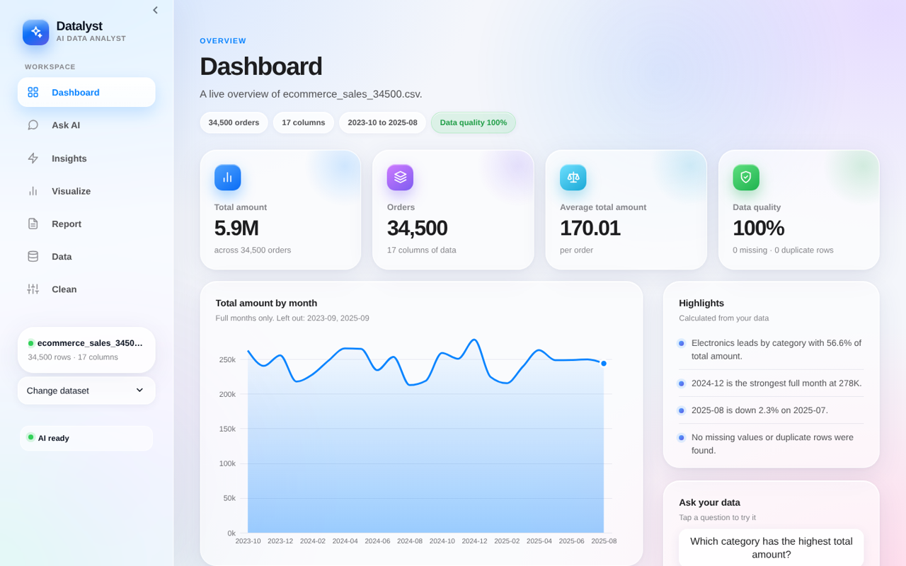
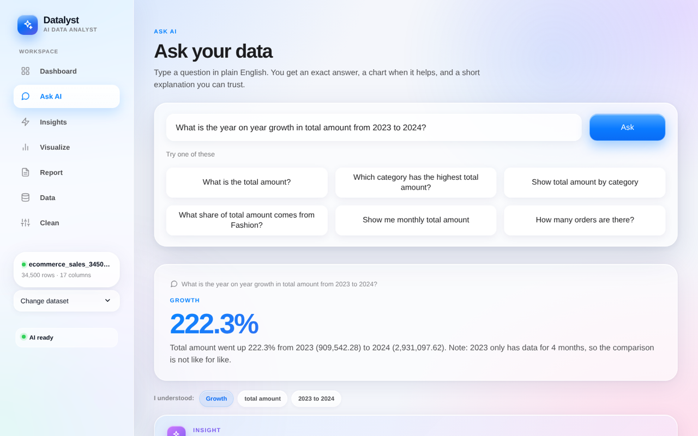
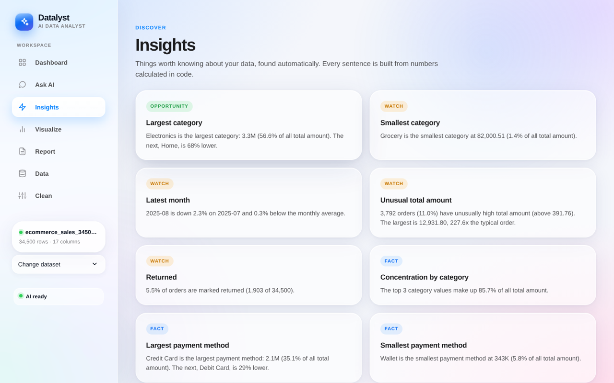
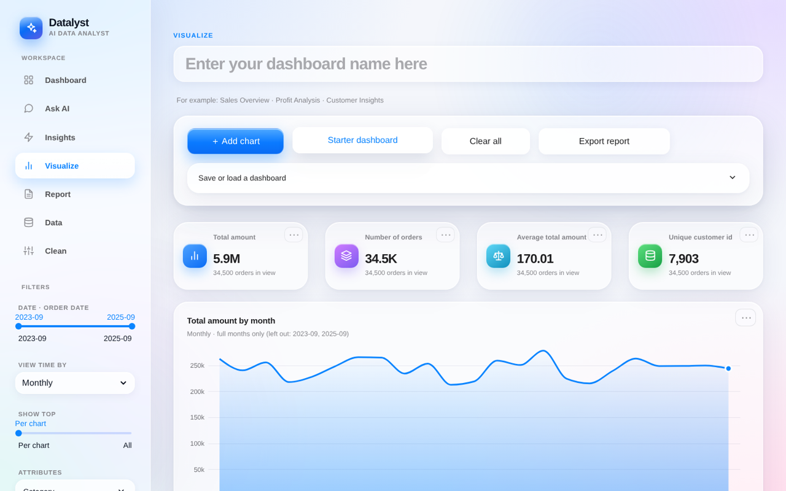
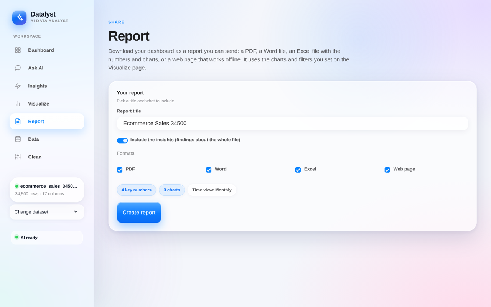
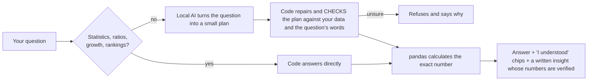

# Datalyst: an AI data analyst you can trust

Upload a spreadsheet, ask questions in plain English, and get **exact answers**.
The AI only *reads the question*. **Every number is calculated by code** and
checked against your real data. When the app is not sure, it says so instead of guessing.



## What it does

| | |
|---|---|
| **Ask AI** | "Which category has the highest revenue?", "What is the year on year growth from 2023 to 2024?", "How many customers placed more than one order?" Follow-ups work too ("and for 2024?", "what about Home?") |
| **What can I ask?** | A panel of example questions written with *your* column names, in 7 groups (totals, rankings, shares, time, statistics, business ratios, customers) |
| **When it is unsure** | It asks instead of refusing: "I could not find 'amout'. Did you mean: total amount?" with one-click buttons |
| **Pin to dashboard** | Turn any table, ranking or trend answer into a chart on your Visualize dashboard (same numbers, checked) |
| **Dashboard** | KPI cards, trend, breakdowns and highlights for any file, with no setup |
| **Insights** | Findings found automatically (leaders, laggards, unusual values, data quality). Every sentence is built from calculated numbers |
| **Visualize** | Build your own dashboard: filters, charts, save and load |
| **Report** | One click to a PDF, Word, Excel (with editable charts) or an offline web page |
| **Data** | See every column: type, blanks, distinct values, examples |
| **Clean it for me** | Finds the problems in a messy file (placeholders like N/A, mixed capitals, extra spaces, text amounts like ₹1,299, duplicates, empty columns), explains each one, lets you tick what to fix, shows before and after, and gives you the cleaned CSV and a change log. Fixes that would invent data (filling blanks) are off by default |

Every answer has **Helpful / Not right** buttons. Your reactions are saved on your computer in
`feedback_log.jsonl` (the question, what the app said and the column names, never your data rows).
`python feedback_report.py` lists what went wrong so each problem can become a test.

It reads CSV and Excel files, including messy ones (Windows encodings, semicolon-separated files,
workbooks with several sheets) and tells you what it decided.

| Ask | Insights |
|---|---|
|  |  |
| **Visualize** | **Report** |
|  |  |

## How it works (why it does not make up numbers)



1. **The AI understands** (a local model through Ollama) and never calculates.
2. **Code checks the plan**: columns, values and filters must exist; the plan must agree with the words of the question.
3. **Python calculates** the exact result, and the explanation is checked number by number.

## Run it

You need Python 3.11 to 3.13 and [Ollama](https://ollama.com).

```bash
# 1. the AI models (about 6 GB, once)
ollama pull qwen2.5:7b
ollama pull llama3.2:3b

# 2. the app
pip install -r requirements.txt
streamlit run app.py
```

Open the link Streamlit prints. The sidebar shows whether the AI is ready. Statistics,
growth, ratio and ranking questions work even when the AI is off.

**Docker (the AI still runs on your computer):**

```bash
docker build -t datalyst .
docker run -p 8501:8501 datalyst
```

## Privacy

When you run it on your own computer, your file stays there. The AI model runs locally. It only sees your question,
the column names and the names of your categories. Nothing is sent to a cloud service. (If you ever host it online, that changes, so tell your users.)

## Test data (not included)

Some tests use three public datasets from Kaggle: `amazon.csv`, `Cleaned_HR_Data_Analysis.csv` and `ecommerce_sales_34500.csv`.
They belong to their authors, so they are not in this repository. The app itself does not need them.
To run the full test suite, download them from Kaggle and put them in the project folder. Without them, the tests that use them will stop with a "file not found" message.
`sample_sales.csv` (included) is enough to try the app.

## How it is tested

Most of this project is its test suite, and one command runs all of it:

```bash
python final_gate.py            # about 10 minutes, no AI needed (see docs/FINAL_GATE.md)
python run_all_tests.py quick   # the core suite, about 5 minutes
```

The layers:

- a **1,311-question analyst catalogue** over 6 generated business datasets, every answer computed independently in pandas
- **11 kinds of AI mistake** simulated, plus **hostile AI output** (plans that contain code, file paths, wrong types)
- **metamorphic tests**: shuffle, double, scale or rename the data and check the answers change exactly as mathematics requires
- **file fuzzing**: thousands of corrupted files and memory bombs must give a polite message, never a crash
- **a robot that clicks the real app at random**, with hostile text, on many different files
- **security checks**: hostile text through every display function, Excel/HTML export injection, a code scan
- **cleaning fuzz**: random messy tables, and rules that must always hold (cleaning twice = once, never adds rows ...)
- **performance gates** on 100,000 rows (500,000 in the long run) and **48,000+ dashboard checks**
- a **mutation audit**: deliberate bugs are injected into the code and the tests must notice
- an automated **accessibility audit** and the design checked on two Streamlit versions

On the author's machine, a real-AI run of **1,000 questions** gave **0 wrong answers**: 873 correct, 124 rightly refused (future, missing data, "delete rows"), and 3 over-cautious declines on questions that had an answer. A wrong answer is treated as a bug; a refusal is allowed. These are my own test questions and runs, not a guarantee. `python final_gate.py` runs all 14 test layers.

A passing run means these attacks found nothing. It cannot prove nothing exists, so every answer has **Helpful / Not right** buttons that turn real use into new tests.

Run `python project_check.py` to verify that every file is the right version.

## Limits (by design)

- It does not forecast or explain causes ("why did sales drop?"). It refuses.
- Business definitions ("active customer", "churn") must be in the data; the app asks rather than guesses.
- English questions. One user at a time. Needs Ollama and about 6 GB of models.
- Tested with Streamlit 1.45 and 1.65 and pandas 2.2 / 2.3 (`requirements.txt` pins this range).
- Not yet tested by people other than the author: the feedback buttons are there so that changes.

## Project map

| File | Role |
|---|---|
| `app.py`, `ui.py`, `builder_ui.py` | The web interface |
| `ask_engine.py`, `question_understanding.py` | Reads the question (AI) and runs the pipeline |
| `plan_repair.py`, `plan_validator.py` | Repairs and checks every plan; refuses when unsure |
| `advanced.py` | Statistics, ratio KPIs, growth, rankings and cross-tabs, answered by code |
| `analysis_pipeline.py`, `metrics.py`, `filters.py` | The exact calculations |
| `file_reader.py`, `cleaning.py`, `data_profiler.py`, `safe_numbers.py`, `compat.py` | Reading files safely, fixing data, understanding columns, number safety, Streamlit version changes |
| `followup.py`, `clarify.py`, `examples.py` | Follow-up questions, "did you mean" buttons, example questions |
| `feedback.py`, `feedback_report.py` | The local feedback log and its report |
| `builder.py`, `report.py`, `insights.py`, `dashboard.py` | Dashboards, exports, insights |
| `test_*.py`, `run_all_tests.py`, `final_gate.py`, `mutation_audit.py` | The test suite and the final audit |

## License

MIT. See `LICENSE`.
